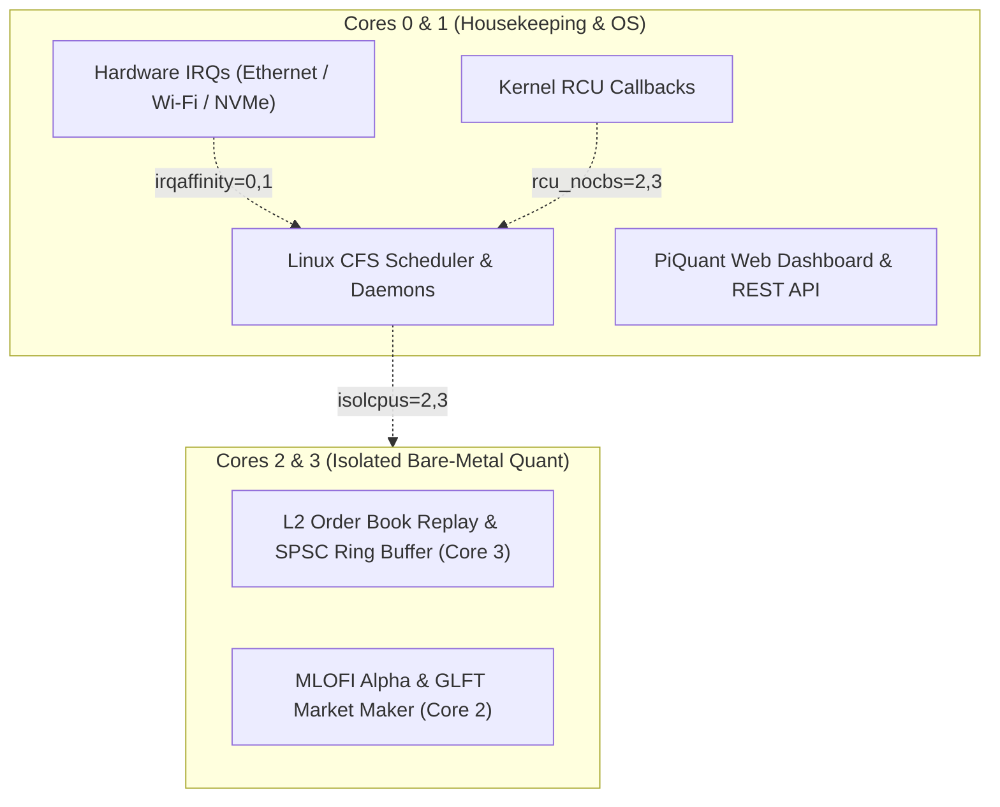

# PiQuant Low-Latency Linux Kernel & Hardware Tuning Guide

This document details how **low-latency kernel tuning**, **task scheduler bypass**, **core isolation**, and **real-time execution (`PREEMPT_RT`)** work in PiQuant when deploying to the target **Raspberry Pi 5** from a development PC.

---

## 1. Development PC vs. Target Hardware Architecture

| Characteristic | Development Host (Current Machine) | Target Node 1: Raspberry Pi 5 | Target Node 2: Raspberry Pi 3B |
|---|---|---|---|
| **Architecture** | x86_64 (AMD Ryzen 9 7950X) | ARM64 (`aarch64`, Cortex-A76) | ARMv7 (`armv7l`, Cortex-A53) |
| **Role** | Codebase development, testing & cross-compilation | High-Frequency Research Engine (`agent`) | Telemetry, UI & Worker Offload (`dashboard`) |
| **RAM** | 32+ GB DDR5 | 8 GB LPDDR4X | 1 GB LPDDR2 |
| **Target OS** | Linux / Ubuntu | Raspberry Pi OS 64-bit (Debian Bookworm) | Raspberry Pi OS 32-bit |
| **Clock Frequency** | Up to 5.7 GHz | 2.40 GHz (Overclockable to 2.80 GHz) | 1.20 GHz |

> [!IMPORTANT]
> You should **never rewrite the Linux operating system from scratch** for an algorithmic trading engine. Replacing the kernel entirely would break the Broadcom BCM2712 hardware device drivers, USB/PCIe root complexes, thermal regulation, and network PHY interfaces.
> 
> Instead, professional institutional quantitative systems achieve **Kernel Bypass** and **Zero-Jitter Execution** by configuring the Linux kernel to step out of the way: isolating CPU cores, disabling timer ticks, locking memory, steering interrupts, and utilizing POSIX Real-Time scheduling.

---

## 2. What "Kernel Bypass" Means on Linux for HFT & Quant

In low-latency Linux engineering, "kernel bypass" refers to preventing the operating system from interrupting or mediating high-frequency execution:



### The 7 Layers of Low-Latency Kernel Optimization Applied:

1. **Task Scheduler Bypass (`isolcpus=2,3`)**:
   - The Linux Completely Fair Scheduler (CFS) is strictly forbidden from placing normal background tasks, systemd units, or user processes on Cores 2 and 3.
   - Only processes explicitly bound via `sched_setaffinity` (or `CPUAffinity=2,3` in systemd) are executed on these cores.

2. **Full Tickless Kernel (`nohz_full=2,3`)**:
   - Standard Linux kernels fire a hardware timer interrupt tick 1,000 times per second (1 kHz) on every core to calculate process time-slices.
   - `nohz_full=2,3` completely turns off the 1,000 Hz timer tick whenever a single thread runs on the isolated core, eliminating context-switch jitter.

3. **RCU Offloading (`rcu_nocbs=2,3`)**:
   - Moves Read-Copy-Update (RCU) garbage collection callbacks out of Cores 2 and 3 onto housekeeping Cores 0 and 1.

4. **Hardware Interrupt (IRQ) Steering (`irqaffinity=0,1`)**:
   - All network interface controller (NIC) packet interrupts, disk I/O, and USB events are trapped on Cores 0 and 1. Cores 2 and 3 experience zero interrupt handling overhead.

5. **Socket Low-Latency Busy-Polling (`net.core.busy_poll=50`)**:
   - Bypasses kernel network `softirqd` sleep/wake cycles.
   - Sockets poll the network interface card's receive queue directly for incoming order book packets, delivering packets straight to user space in nanoseconds.

6. **CPU Frequency Governor Lock (`performance`)**:
   - Standard Linux dynamic governors (`ondemand` or `schedutil`) down-clock idle cores to 600 MHz to save power, introducing a 2–5 millisecond latency penalty when waking up for a price spike.
   - PiQuant permanently locks all 4 Cortex-A76 cores at 2.4 GHz `performance` mode via `piquant-governor.service`.

7. **Zero-Paging & Infinite Memlock (`LimitMEMLOCK=infinity`, `vm.swappiness=1`)**:
   - Memory is locked into physical LPDDR4X RAM using `mlockall` / `CAP_IPC_LOCK`.
   - The Linux kernel is prevented from paging or swapping out order book depth tables to disk.

---

## 3. Automated Setup on the Raspberry Pi 5

When you transfer the release package from your development computer to the Raspberry Pi 5, the optimizations can be applied automatically or individually.

### Quick Automatic Installation (Includes Kernel Tuning):
```bash
# On your development PC, build the release bundle:
make package

# Transfer to Raspberry Pi 5:
scp bin/piquant-release.tar.gz pi@piquant-core.local:/tmp/

# SSH into the Raspberry Pi 5:
ssh pi@piquant-core.local
tar -xzvf /tmp/piquant-release.tar.gz
cd piquant-release

# Run installer (automatically detects Pi 5, applies tuning & installs systemd service):
sudo ./scripts/install.sh agent
```

---

## 4. Standalone Kernel Tuning Script (`scripts/tune-kernel.sh`)

You can run the tuner directly on the Raspberry Pi 5 with the following commands:

### A. Inspect Current Kernel State
```bash
sudo ./scripts/tune-kernel.sh check
```
Reports active CPU governors, frequencies, isolated cores, tickless cores, sysctl socket parameters, and real-time limits.

### B. Apply Low-Latency Optimizations
```bash
sudo ./scripts/tune-kernel.sh apply
```
Applies:
- `/etc/sysctl.d/99-piquant-rt.conf`
- `/etc/security/limits.d/99-piquant-rt.conf`
- `/etc/systemd/system/piquant-governor.service`
- Appends `isolcpus=2,3 nohz_full=2,3 rcu_nocbs=2,3 irqaffinity=0,1 transparent_hugepage=always audit=0 nosoftlockup` to `/boot/firmware/cmdline.txt`.

### C. Install Real-Time Linux Kernel (`PREEMPT_RT`)
To install the official 64-bit real-time kernel for Raspberry Pi OS:
```bash
sudo ./scripts/tune-kernel.sh rt-kernel
```
*Note: A reboot is required after updating kernel boot parameters or installing a real-time kernel (`sudo reboot`).*

### D. Revert to Factory Settings
If you ever want to revert all kernel parameters to default:
```bash
sudo ./scripts/tune-kernel.sh revert
```

---

## 5. Verification Commands on Raspberry Pi 5

After rebooting the Raspberry Pi 5 with kernel tuning active, verify the isolation:

```bash
# 1. Verify isolated cores
cat /sys/devices/system/cpu/isolated
# Output: 2-3

# 2. Verify tickless cores
cat /sys/devices/system/cpu/nohz_full
# Output: 2-3

# 3. Verify CPU governor frequency (should be 2400000 kHz on all 4 cores)
cat /sys/devices/system/cpu/cpu*/cpufreq/scaling_cur_freq

# 4. Verify systemd real-time scheduling priority (FIFO 80)
systemctl status piquant-agent.service
```
